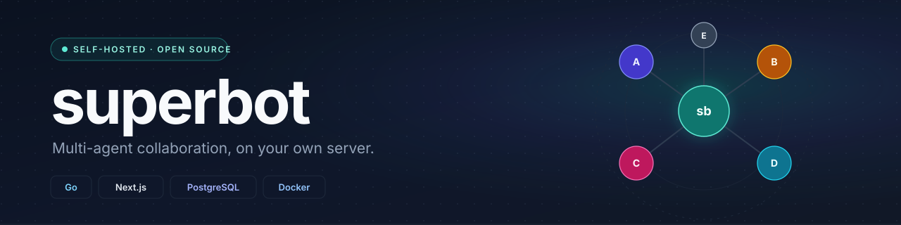
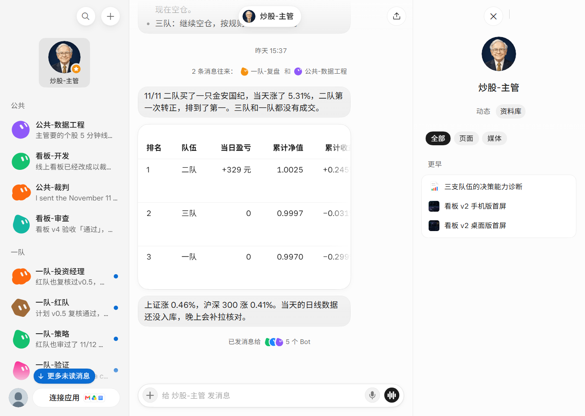
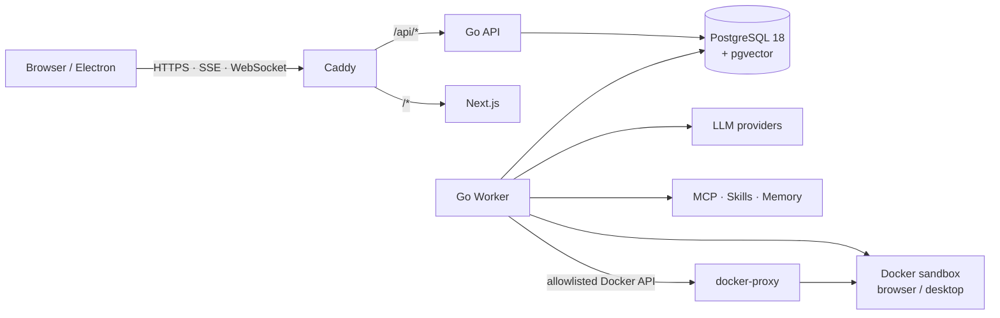

<p align="center">
  
</p>

<p align="center">
  <a href="https://github.com/vulgar-sir/superbot/actions/workflows/ci.yml"></a>
  <a href="LICENSE"></a>
  
  
  
  
</p>

<p align="center">
  <strong>English</strong> · <a href="README.zh-CN.md">简体中文</a>
</p>

**superbot** is a self-hosted, open-source multi-agent collaboration platform. Create configurable bots, put them in a room with you and with each other, give them a team, a shared workspace, a browser, a cloud computer and long-term memory — then let them actually do the work.

Most chat products give you one assistant. superbot is built around the idea that useful agents need **peers, shared context and a place to work**. Bots can @mention each other, send private messages, hand off tasks, review each other's output, and keep working while you are away. Everything runs on your own server: your data, your models, your rules.

<p align="center">
  
</p>
<p align="center"><em>A room with several bots, shared activity and a library panel. The UI ships in Chinese and English, with dark and light themes.</em></p>

## Highlights

### Bots that are more than a system prompt

Each bot has a persona, its own model, a tool policy, a private workspace, long-term memory, and optionally a persistent browser or XFCE desktop. An account-level **main bot** can act as the default identity for the sidebar and for group fallbacks.

### Teams and rooms

- **Roundtable** — bots discuss in turns and converge on an answer.
- **Pipeline** — a task flows through ordered stages.
- **Router–Worker** — a coordinator splits work and dispatches to specialists.
- **Group** — a Grok-style room with up to six bots, @-mention driven, no central coordinator.

Humans and bots share the same room: streaming output, mentions, stop, visible token cost, tool-call timelines, and folded bot-to-bot private messages.

### Real work, not just text

- **Shell, Python, files** inside a per-bot sandbox.
- **Browser** — persistent Chromium sessions, CDP access, live takeover through noVNC.
- **Cloud computer** — a full XFCE desktop per bot, with update (keep files) and reset (wipe workspace).
- **Local device agent** — `superbot device` polls for jobs; the user must explicitly approve each shell command. Jobs and results are Ed25519-signed.
- **MCP and Skills** — built-in skills, user skills, bot-proposed skills, and HTTP MCP servers.
- **Connectors** — GitHub device-code auth, Slack, Notion, 1Password, Email, CalDAV.
- **Vault** — logins, payment details and contact information encrypted with AES-256-GCM; secrets are revealed only on explicit request.

### Built for long-running work

- Conversation checkpoints keep structured notes and the user's exact words; `search_chat_history` can retrieve the original text.
- Tool loops are compressed against a token budget instead of failing.
- A restarted worker resumes from the last tool round instead of replaying the whole task.
- Interjections sent while a bot is working are delivered before its next model call; `/side` asks a question without interrupting or writing to the transcript.
- `send_to_agent` replies and subagent results wake the initiator, with relay and wake-up limits.
- Group goals let the lead bot align acceptance criteria with you, split phases, assign work, and verify each phase with evidence — then stop when done.

### Memory that behaves like memory

Relevance-thresholded recall, write-time deduplication, rejection of suspected secrets, idle-time review, recoverable daily consolidation, pinning and archiving. Embeddings can come from a self-hosted service or any OpenAI-compatible endpoint.

### Multi-model, observable, self-hosted

- OpenAI-compatible providers (DeepSeek, Qwen, Moonshot, GLM, Volcengine Ark, Ollama, …) and the Anthropic Messages API.
- Retries with `Retry-After` handling, streaming idle-timeout detection, per-provider timeouts.
- Every message, tool call, token count and cost lands in an event stream that can be replayed and audited.
- Self-hosted embedding, STT and TTS services are included in the deployment stack.
- WebAuthn/Passkeys, OIDC/SSO, SMTP, ICS calendars, team accounts and role isolation.

### Desktop app

An Electron client with a frameless window, native menu/tray/notifications, a local device agent, capture overlay, and NSIS auto-update support. The web app remains the source of truth.

## Architecture



- A single Go binary provides `serve`, `worker` and `migrate`; the frontend is Next.js 16.
- PostgreSQL is the business database, the job queue (`SKIP LOCKED`) and the event bus — no Redis required for the first version.
- Each bot gets a persistent workspace container; teams share a directory mounted at `/teams/<team-id>/shared`.
- Browser containers include Chromium, Xvfb, x11vnc and noVNC; CDP is exposed to the worker through a container-local proxy.
- The worker never holds the Docker socket. It talks to `docker-proxy`, which only allows sandbox lifecycle endpoints and validates every create request.

## Quick start

### Production-style deployment with Docker Compose

**Requirements:** Docker Engine + Compose v2, a Linux host. 8 vCPU / 16 GB RAM / 200 GB SSD is a good starting point; 16 vCPU / 32 GB is recommended if you plan to run several browser or desktop bots. Ubuntu 24.04 or Debian 13.

```bash
git clone https://github.com/vulgar-sir/superbot.git
cd superbot

cp deploy/.env.production.example .env
# Edit .env: SUPERBOT_SECRET_KEY, SUPERBOT_ADMIN_*,
# POSTGRES_PASSWORD and your LLM API key.

# Build the API/web image and the two computer images.
docker compose --env-file .env -f deploy/docker-compose.yml build api web
docker build -t superbot/computer:latest \
  -f deploy/images/computer/Dockerfile deploy/images/computer
docker build -t superbot/computer-desktop:latest \
  -f deploy/images/computer/Dockerfile.desktop deploy/images/computer

# One-time data directory layout (root-owned parents, uid-1000 leaves).
sudo mkdir -p /srv/superbot/data
sudo bash deploy/harden-data-permissions.sh /srv/superbot/data

# Start the core stack (SSO, voice and embedding are optional; see below).
docker compose --env-file .env -f deploy/docker-compose.yml \
  up -d postgres api worker docker-proxy web caddy
```

Open **http://&lt;server&gt;:32608** (or `http://localhost:32608` on the host itself) and sign in with the admin account from `.env`.

> **Before exposing superbot to the internet:** put it behind a domain with TLS. WebAuthn/Passkeys require a secure context, and session cookies should not travel over plain HTTP. Set `SUPERBOT_COOKIE_INSECURE=false` and `SUPERBOT_ALLOW_INSECURE_COOKIE=false` once HTTPS is in place.

Optional services in the same compose file:

| Service | Start with | Notes |
|---|---|---|
| `dex` | `docker compose ... up -d dex` | Self-hosted OIDC/SSO. Copy `deploy/dex/config.example.yaml` to `dex/config.yaml` first. |
| `embedding` | `docker compose ... up -d embedding` | Self-hosted `intfloat/multilingual-e5-large`; the first start downloads the model. |
| `stt` / `tts` | `docker compose ... up -d stt tts` | faster-whisper and Piper voice services. |

The full deployment notes, backup script and integration-test script live in [`deploy/`](deploy/).

### Local development

**Requirements:** Go 1.27+, Node.js 24+, Docker Desktop (or Docker Engine).

```bash
cp .env.example .env            # fill in SUPERBOT_SECRET_KEY and your API key
task dev-infra                  # local Postgres on port 55432
task migrate                    # apply database migrations

# in three terminals:
task api                        # http://127.0.0.1:8080
task worker
task web                        # http://127.0.0.1:3000
```

Without [Task](https://taskfile.dev/), run `go run ./cmd/superbot serve`, `go run ./cmd/superbot worker` and `npm run dev` in `web/` directly.

On first boot superbot creates the admin account. With no provider configured, `SUPERBOT_DEEPSEEK_API_KEY` is used to seed a DeepSeek provider.

## Deploy with an AI assistant

You can hand the deployment to Claude Code, Codex, Cursor or another AI agent. Give it the repository URL, your server connection details and the prompt from **[docs/deploy-with-ai.md](docs/deploy-with-ai.md)**. The agent is instructed to read the repository first, run read-only preflight checks, present a plan, and wait for your approval before changing the server.

Short version:

```text
You are an experienced SRE / DevOps agent. Deploy superbot on my server.

Project: https://github.com/vulgar-sir/superbot
Server: <host>, SSH port <port>, user <deploy-user>, key <path>
OS/resources: <Ubuntu 24.04, 8C16G, 200GB>
Domain/TLS: <domain or none>
LLM: <provider/model; key is at <path on the server>>

Read README.md, deploy/ and docs/deploy-with-ai.md first.
Run read-only preflight checks and show me a plan; wait for my approval before changing anything.
Never echo secrets; set .env to mode 600. Stop and ask before destructive commands, firewall/DNS/port changes, or sudo.
After deployment, verify with the acceptance checklist and send a hand-off report.
```

The full guide includes a fill-in connection card, a complete prompt, the exact runbook, an acceptance checklist and a security contract. Read it before giving an AI access to a real server: **[docs/deploy-with-ai.md](docs/deploy-with-ai.md)**.

## How to use superbot

1. **Add a model provider** in **Settings → Providers** (DeepSeek, any OpenAI-compatible endpoint, Anthropic, or local Ollama). Set the context window, price and vision/tool capabilities in the model catalog.
2. **Create a bot** from the sidebar, then open **Details** to give it a persona, a tool policy, a workspace, memory and — only if needed — a browser or computer.
3. **Send a task.** In a single-bot room, just write to the bot. In a group, mention the bots you want with `@BotName`; unmentioned bots stay quiet and the main bot is the fallback.
4. **Steer and verify.** Use `/side` for a side question, interject while a bot works, stop a run, approve high-risk tools, and inspect tool calls, tokens and cost in the right panel.
5. **Make it repeatable.** Turn recurring work into a cron/`@every` routine, save a group as a team, or set a group goal with acceptance criteria.

A useful prompt has eight parts: **role, goal, context, constraints, tools, deliverable, acceptance criteria and evidence**. For example:

```text
You are my research assistant. Goal: research the 2026 Chinese AI phone market
and produce a decision memo of at most 1,500 words.

Context: the reader is a product lead; use public sources only.
Constraints: every key conclusion needs a source link and date; separate fact,
inference and unknown; never invent data.
Deliverable: a one-page summary, a key-player comparison table, three
opportunities with risks, and a source list.
Acceptance: every number can be found in a source.
Evidence: list the links you actually opened.

First give me a four-step plan and wait for my confirmation.
```

The full guide, with copy-paste templates for coding, browser work, group collaboration, long tasks, routines and review, is in **[docs/usage.md](docs/usage.md)** (English) and **[docs/usage.zh-CN.md](docs/usage.zh-CN.md)** (中文).

## Configuration

The templates document every supported variable:

- [`.env.example`](.env.example) — local development.
- [`deploy/.env.production.example`](deploy/.env.production.example) — production Compose.

| Variable | Purpose |
|---|---|
| `SUPERBOT_SECRET_KEY` | 32 random bytes, base64. Encrypts provider/MCP secrets. Losing it makes existing ciphertext unrecoverable. |
| `SUPERBOT_DATABASE_URL` | PostgreSQL DSN. |
| `SUPERBOT_ADMIN_EMAIL` / `SUPERBOT_ADMIN_PASSWORD` | First-boot admin account. |
| `SUPERBOT_DATA_DIR` | Workspaces, skills, attachments and artifacts. |
| `SUPERBOT_SANDBOX_NETWORK` | Set to `superbot_sandbox` in production. |
| `SUPERBOT_SANDBOX_IMAGE` | Defaults to `superbot/computer:latest`. |
| `SUPERBOT_ALLOW_INSECURE_COOKIE` | Must be explicitly `true` for plain-HTTP deployments. |
| `SUPERBOT_COOKIE_INSECURE` | Set to `false` behind HTTPS. |

## Security model

superbot executes real commands, so the security boundaries are part of the design, not an afterthought:

- Provider and MCP secrets are encrypted with AES-256-GCM and never returned in plaintext by the API.
- File tools are confined with Go's `os.Root`; `fetch_url` blocks private networks, loopback and cloud metadata endpoints.
- Sandboxes are non-privileged, drop all capabilities, set resource limits and get isolated workspaces. Each bot mounts only the shared directory of the teams it belongs to. Production browser containers join a dedicated Docker network and publish no host ports.
- The worker has no Docker socket. `docker-proxy` allowlists only sandbox lifecycle endpoints and validates every create request. API and worker run as uid 1000; run `deploy/harden-data-permissions.sh` so sandbox mount sources are read-only to them.
- MCP and skill content is treated as untrusted input. Extension changes are written to the audit log.
- Vault entries are encrypted at rest and revealed only through an explicit action.

Please read [`SECURITY.md`](SECURITY.md) before exposing an instance to the internet, and report vulnerabilities privately rather than in a public issue.

## Documentation

| Document | Language | What it covers |
|---|---|---|
| [`docs/functional-parity-matrix.md`](docs/functional-parity-matrix.md) | 中文 | The single source of truth for feature completeness and verification evidence. |
| [`docs/configuration-required.md`](docs/configuration-required.md) | 中文 | Features that need external credentials, network access or platform support. |
| [`docs/pending-verification.md`](docs/pending-verification.md) | 中文 | Items still awaiting real-world verification. |
| [`docs/ui-parity-checklist.md`](docs/ui-parity-checklist.md) | 中文 | UI alignment checklist and measurements. |
| [`deploy/`](deploy/) | English | Compose stack, Caddy, sandbox images, backups, Dex and soak tests. |
| [`desktop/README.md`](desktop/README.md) | English | Electron client, device agent and auto-update feed. |
| [`CONTRIBUTING.md`](CONTRIBUTING.md) | English / 中文 | Development setup, standards and pull-request checklist. |
| [`ACKNOWLEDGMENTS.md`](ACKNOWLEDGMENTS.md) | English / 中文 | The open-source projects and people this work depends on. |

Some deep-dive documents are currently written in Chinese; translation contributions are very welcome.

## Project status

superbot is usable and under active development. The current focus is reliability, security hardening and the desktop client. The parity matrix records exactly what has been verified and what still needs external credentials or platform support — it does not pretend a feature works when it does not.

Known limits:

- Single-node deployment. No Kubernetes or cross-machine distributed workers yet.
- No native mobile app.
- Third-party OAuth applications (Teams, Google, Outlook, meeting platforms, Twilio, X) are intentionally deferred; bring-your-own credentials are supported where implemented.
- Windows/macOS desktop builds are unsigned by default; production releases need a code-signing certificate.
- Some optional capabilities need a domain with HTTPS, a public IP with outbound access, or paid third-party accounts.

See [`docs/functional-parity-matrix.md`](docs/functional-parity-matrix.md) for the authoritative status.

## Contributing

Contributions of all sizes are welcome: bug reports, documentation, translations, UI polish, tests and features.

1. Read [`CONTRIBUTING.md`](CONTRIBUTING.md) and [`CODE_OF_CONDUCT.md`](CODE_OF_CONDUCT.md).
2. For a large change, open an issue first so we can agree on the scope.
3. Run `go test ./...`, `go vet ./...`, and `npm run typecheck && npm run build` in `web/` before opening a pull request.
4. Never include real API keys, server addresses or personal data in code, tests, screenshots or logs.

Security issues must be reported privately — see [`SECURITY.md`](SECURITY.md).

## Acknowledgments

superbot stands on the shoulders of the open-source community. Thanks to the Go, Next.js, React, Tailwind CSS, PostgreSQL/pgvector, Caddy, Docker, Chromium, noVNC, faster-whisper, Piper, Dex, Electron, Playwright and many other projects that make this possible. The full list, and the people who helped test and review the project, is in [`ACKNOWLEDGMENTS.md`](ACKNOWLEDGMENTS.md).

The UI and interaction patterns were informed by modern chat products, including Grok (xAI). All code in this repository is an independent implementation. superbot is not affiliated with, sponsored by, or endorsed by xAI or any other product mentioned in the documentation. Product names and trademarks belong to their respective owners.

## License

superbot is released under the **GNU Affero General Public License v3.0 (AGPL-3.0)**. See [`LICENSE`](LICENSE) and [`NOTICE`](NOTICE).

You are free to use, study, modify and self-host superbot, including commercially. If you modify superbot and let users interact with it over a network, the AGPL requires you to offer those users the corresponding source code. If that does not fit your use case, a separate commercial license can be discussed with the maintainer.

Copyright © 2026 qihai (vulgar-sir) and the superbot contributors.
