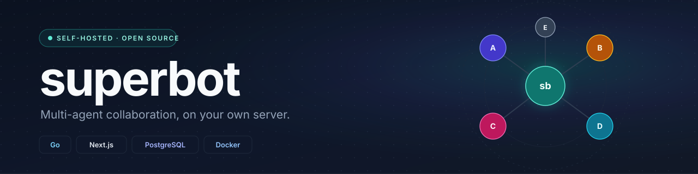
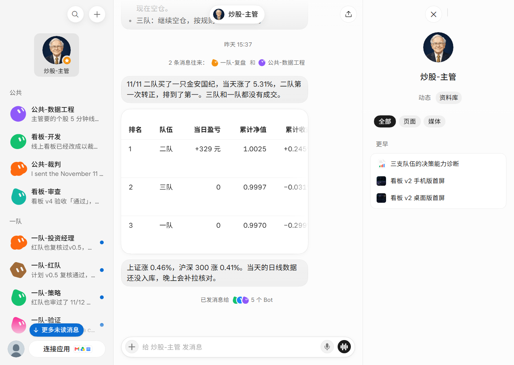
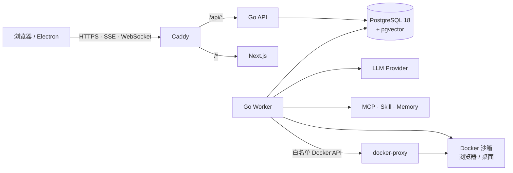

<p align="center">
  
</p>

<p align="center">
  <a href="https://github.com/vulgar-sir/superbot/actions/workflows/ci.yml"></a>
  <a href="LICENSE"></a>
  
  
  
  
</p>

<p align="center">
  <a href="README.md">English</a> · <strong>简体中文</strong>
</p>

**superbot** 是一个自托管、开源的多 Agent 协作平台。你可以创建可配置的 Bot，把它们和你放进同一个房间，也允许它们彼此对话；给它们团队、共享工作区、浏览器、云电脑和长期记忆，然后让它们真正把活干完。

大多数聊天产品只给你一个助手。superbot 的出发点是：有用的 Agent 需要**同伴、共享上下文和一个能干活的地方**。Bot 可以互相 @、发私信、交接任务、审查彼此的产出，并在你离开后继续工作。所有东西都跑在你自己的服务器上：你的数据、你的模型、你的规则。

<p align="center">
  
</p>
<p align="center"><em>一个多 Bot 房间：共享动态、消息流与右侧资料库。界面支持中英文与深浅色主题。</em></p>

## 亮点

### Bot 不只是一段系统提示词

每个 Bot 都有自己的设定、独立模型、工具策略、私有工作区、长期记忆，以及可选的持久浏览器或 XFCE 云电脑。账号级的**主 Bot** 可以作为侧栏和群聊兜底的默认身份。

### 团队与房间

- **圆桌** — 多个 Bot 轮流讨论，最终收敛出答案。
- **流水线** — 任务按顺序流经各个阶段。
- **Router–Worker** — 协调者拆解任务并分派给专家。
- **群聊（Group）** — Grok 风格房间，最多 6 个 Bot，由 @ 驱动，没有中心协调者。

人和 Bot 共处同一个房间：流式输出、@ 提及、随时停止、成本可见、工具调用时间线，以及折叠展示的 Bot 间私信。

### 真的能干活

- **Shell、Python、文件操作**运行在每 Bot 独立的沙箱中。
- **浏览器** — 持久 Chromium 会话、CDP 接入、通过 noVNC 实时接管。
- **云电脑** — 每个 Bot 一台完整 XFCE 桌面，支持「更新（保留文件）」和「重置（清空工作区）」。
- **本地设备 Agent** — `superbot device` 轮询任务；每条 shell 命令都必须由你显式批准。任务与结果使用 Ed25519 签名。
- **MCP 与 Skill** — 内置技能、用户技能、Bot 自提议技能，以及 HTTP MCP 服务。
- **连接器** — GitHub 设备码授权、Slack、Notion、1Password、Email、CalDAV。
- **保险库（Vault）** — 登录信息、支付信息和联系信息使用 AES-256-GCM 加密，只有显式查看时才返回明文。

### 为长任务设计

- 对话过长时自动整理成「检查点」：结构化笔记 + 用户原话逐字保留；`search_chat_history` 可以回查原文。
- 工具循环按 token 预算压缩，而不是直接失败。
- Worker 重启后从上一个工具轮次续跑，而不是重放整个任务。
- Bot 干活时发送的消息会在它下一次模型调用前送达；`/side` 允许旁路提问，不打断任务，也不写入对话。
- `send_to_agent` 的回复和子代理结果会自动送回发起方并唤醒它，带接力与唤醒上限。
- 群目标让群主 Bot 与你对齐验收标准、拆分阶段、分派任务、凭证据逐段验收，并在完成后自己停下。

### 像记忆的记忆

按相关度阈值召回、写入去重、疑似密钥拒绝入库、空闲时自动回顾提炼、可恢复的每日整理、置顶与归档。Embedding 可以使用自托管服务，也可以接任意 OpenAI 兼容端点。

### 多模型、可观测、完全自托管

- OpenAI 兼容 Provider（DeepSeek、Qwen、Moonshot、GLM、火山方舟、Ollama 等）与 Anthropic Messages API。
- 请求自动重试（429/5xx，遵守 `Retry-After`）、流空闲超时检测、按 Provider 配置超时。
- 所有消息、工具调用、token 与成本写入事件流，可回放、可审计。
- 部署栈内置自托管 embedding、STT 与 TTS 服务。
- WebAuthn/Passkey、OIDC/SSO、SMTP、ICS 日历、多账号与角色隔离。

### 桌面端

Electron 客户端提供无边框窗口、原生菜单/托盘/通知、本地设备代理、截图 overlay 和 NSIS 自动更新。Web 应用始终是唯一事实来源。

## 架构



- 一个 Go 二进制提供 `serve`、`worker`、`migrate`；前端是 Next.js 16。
- PostgreSQL 同时承担业务数据、任务队列（`SKIP LOCKED`）和事件总线，首版不依赖 Redis。
- 每个 Bot 一个持久工作区容器；团队共享目录挂载到 `/teams/<team-id>/shared`。
- 浏览器容器内置 Chromium、Xvfb、x11vnc 和 noVNC；CDP 通过容器内代理暴露给 Worker。
- Worker 不持有 Docker socket，只通过 `docker-proxy` 访问；代理只放行沙箱生命周期端点，并校验每个创建请求。

## 快速开始

### 用 Docker Compose 部署（生产形态）

**前置条件：** Docker Engine + Compose v2，Linux 主机。起步建议 8 vCPU / 16 GB 内存 / 200 GB SSD；如果要同时跑多个浏览器或桌面 Bot，建议 16 vCPU / 32 GB。Ubuntu 24.04 或 Debian 13。

```bash
git clone https://github.com/vulgar-sir/superbot.git
cd superbot

cp deploy/.env.production.example .env
# 编辑 .env：SUPERBOT_SECRET_KEY、SUPERBOT_ADMIN_*、
# POSTGRES_PASSWORD，以及你的 LLM API Key。

# 构建 API/Web 镜像和两个电脑镜像
docker compose --env-file .env -f deploy/docker-compose.yml build api web
docker build -t superbot/computer:latest \
  -f deploy/images/computer/Dockerfile deploy/images/computer
docker build -t superbot/computer-desktop:latest \
  -f deploy/images/computer/Dockerfile.desktop deploy/images/computer

# 一次性数据目录布局（父目录 root 所有，叶子目录 uid 1000）
sudo mkdir -p /srv/superbot/data
sudo bash deploy/harden-data-permissions.sh /srv/superbot/data

# 启动核心服务（SSO、语音、embedding 是可选服务，见下）
docker compose --env-file .env -f deploy/docker-compose.yml \
  up -d postgres api worker docker-proxy web caddy
```

打开 **http://&lt;服务器&gt;:32608**（在服务器本机则用 `http://localhost:32608`），用 `.env` 里的管理员账号登录。

> **暴露到公网之前：** 请放在域名和 TLS 后面。WebAuthn/Passkey 需要安全上下文，会话 Cookie 也不应该走明文 HTTP。启用 HTTPS 后把 `SUPERBOT_COOKIE_INSECURE` 和 `SUPERBOT_ALLOW_INSECURE_COOKIE` 设为 `false`。

同一份 compose 里的可选服务：

| 服务 | 启动方式 | 说明 |
|---|---|---|
| `dex` | `docker compose ... up -d dex` | 自托管 OIDC/SSO。先把 `deploy/dex/config.example.yaml` 复制为 `dex/config.yaml`。 |
| `embedding` | `docker compose ... up -d embedding` | 自托管 `intfloat/multilingual-e5-large`，首次启动会下载模型。 |
| `stt` / `tts` | `docker compose ... up -d stt tts` | faster-whisper 与 Piper 语音服务。 |

更完整的部署说明、备份脚本和集成测试脚本在 [`deploy/`](deploy/)。

### 本地开发

**前置条件：** Go 1.27+、Node.js 24+、Docker Desktop（或 Docker Engine）。

```bash
cp .env.example .env            # 填入 SUPERBOT_SECRET_KEY 和你的 API Key
task dev-infra                  # 本地 Postgres，端口 55432
task migrate                    # 执行数据库迁移

# 三个终端：
task api                        # http://127.0.0.1:8080
task worker
task web                        # http://127.0.0.1:3000
```

没有 [Task](https://taskfile.dev/) 时，可以直接运行 `go run ./cmd/superbot serve`、`go run ./cmd/superbot worker`，并在 `web/` 下运行 `npm run dev`。

首次启动会自动创建管理员；如果还没有配置任何 Provider，会用 `SUPERBOT_DEEPSEEK_API_KEY` 种子化一个 DeepSeek Provider。

## 让 AI 帮你部署

你可以把部署交给 Claude Code、Codex、Cursor 或其他 AI Agent。把**项目链接**、**服务器连接方式**和 **[docs/deploy-with-ai.zh-CN.md](docs/deploy-with-ai.zh-CN.md)** 里的提示词交给它；指南要求 AI 先读仓库、做只读预检、给出计划，得到你确认后才修改服务器。

短版提示词：

```text
你是一名经验丰富的 SRE / DevOps Agent。请帮我在我的服务器上部署 superbot。

项目: https://github.com/vulgar-sir/superbot
服务器: <host>，SSH 端口 <port>，用户 <deploy-user>，密钥 <path>
系统/配置: <Ubuntu 24.04，8C16G，200GB>
域名/TLS: <域名或“无”>
LLM: <Provider/模型；Key 在服务器的 <path>>

先读 README.md、deploy/ 和 docs/deploy-with-ai.zh-CN.md。
先做只读预检并给我计划；等我确认后再修改服务器。
不要回显密钥；.env 权限设为 600。遇到破坏性命令、防火墙/DNS/端口改动或 sudo，先停下来问我。
部署完成后按验收清单验证，并给我一份交付报告。
```

完整指南包含可填写的连接卡、完整提示词、精确执行步骤、验收清单和安全红线。把服务器交给 AI 之前请先读一遍：**[docs/deploy-with-ai.zh-CN.md](docs/deploy-with-ai.zh-CN.md)**。

## 使用说明

1. **配置模型**：设置 → Provider，添加 DeepSeek、任意 OpenAI 兼容端点、Anthropic 或本机 Ollama；在模型目录里维护上下文长度、价格、视觉/工具能力。
2. **创建 Bot**：侧栏 **+** 创建，点 **详情** 配置人设、工具策略、工作区、记忆；需要上网或图形界面时再开启浏览器/云电脑。
3. **发任务**：单 Bot 房间直接发消息；群聊里用 `@BotName` 点名，没被 @ 的 Bot 不会说话，主 Bot 兜底。
4. **纠偏与验收**：`/side` 旁路提问、Bot 干活时插话、随时停止、审批高风险工具；右侧面板查看工具调用、token 与成本。
5. **变成可复用流程**：把重复工作做成 cron / `@every` 例程，把群聊保存为团队，或用「群目标」约定验收标准。

一个好提示词通常包含八部分：**角色、目标、背景、约束、工具、交付物、验收标准、证据**。例如：

```text
你是我的研究助理。目标：调研 2026 年中国 AI 手机市场，输出 1500 字以内的决策摘要。

背景：读者是产品负责人；只使用公开可查的资料。
约束：每条关键结论附来源链接和日期；区分事实、推断和未知；不要编造数据。
交付：一页摘要、关键玩家对比表、三个机会点与风险、来源清单。
验收：每个数字都能在来源里找到。
证据：列出你实际打开的链接。

先给出 4 步执行计划，等我确认后再开始。
```

完整指南、以及编码、浏览器操作、群聊协作、长任务、例程和审查的可复制模板见 **[docs/usage.zh-CN.md](docs/usage.zh-CN.md)**（中文）与 **[docs/usage.md](docs/usage.md)**（English）。

## 配置

两个模板覆盖了全部支持的环境变量：

- [`.env.example`](.env.example) — 本地开发。
- [`deploy/.env.production.example`](deploy/.env.production.example) — 生产 Compose。

| 变量 | 作用 |
|---|---|
| `SUPERBOT_SECRET_KEY` | 32 字节随机数的 base64；加密 Provider/MCP 密钥。丢失后已有密文不可恢复。 |
| `SUPERBOT_DATABASE_URL` | PostgreSQL DSN。 |
| `SUPERBOT_ADMIN_EMAIL` / `SUPERBOT_ADMIN_PASSWORD` | 首次启动的管理员账号。 |
| `SUPERBOT_DATA_DIR` | 工作区、技能、附件与产物目录。 |
| `SUPERBOT_SANDBOX_NETWORK` | 生产环境设为 `superbot_sandbox`。 |
| `SUPERBOT_SANDBOX_IMAGE` | 默认 `superbot/computer:latest`。 |
| `SUPERBOT_ALLOW_INSECURE_COOKIE` | 纯 HTTP 部署时必须显式设为 `true`。 |
| `SUPERBOT_COOKIE_INSECURE` | HTTPS 部署时设为 `false`。 |

## 安全模型

superbot 会执行真实命令，所以安全边界是设计的一部分，而不是事后补丁：

- Provider/MCP 密钥使用 AES-256-GCM 加密，API 永不回显明文。
- 文件工具使用 Go 的 `os.Root` 限定根目录；`fetch_url` 拦截私网、回环和云元数据地址。
- 沙箱非特权、cap-drop ALL、设置资源限额、工作区隔离。每个 Bot 只挂载自己所在团队的共享目录。生产浏览器容器只加入专用 Docker 网络，不发布宿主机端口。
- Worker 不持有 Docker socket；`docker-proxy` 只放行沙箱生命周期端点并校验每个创建请求。API 与 Worker 以 uid 1000 运行；执行 `deploy/harden-data-permissions.sh` 后，沙箱挂载源对它们只读。
- MCP/Skill 内容按不可信输入处理；扩展变更写入审计日志。
- 保险库条目静态加密，只有显式操作才会返回明文。

把实例暴露到公网前，请先读 [`SECURITY.md`](SECURITY.md)，并通过私有渠道报告漏洞，不要开公开 issue。

## 文档

| 文档 | 语言 | 内容 |
|---|---|---|
| [`docs/functional-parity-matrix.md`](docs/functional-parity-matrix.md) | 中文 | 功能完成度与验收证据的唯一事实来源。 |
| [`docs/configuration-required.md`](docs/configuration-required.md) | 中文 | 需要外部凭据、网络或平台支持的能力。 |
| [`docs/pending-verification.md`](docs/pending-verification.md) | 中文 | 仍待真实验收的条目。 |
| [`docs/ui-parity-checklist.md`](docs/ui-parity-checklist.md) | 中文 | UI 对齐清单与实测尺寸。 |
| [`deploy/`](deploy/) | English | Compose 栈、Caddy、沙箱镜像、备份、Dex 与 soak 测试。 |
| [`desktop/README.md`](desktop/README.md) | English | Electron 客户端、设备代理与自动更新 feed。 |
| [`CONTRIBUTING.md`](CONTRIBUTING.md) | English / 中文 | 开发环境、规范与 PR 清单。 |
| [`ACKNOWLEDGMENTS.md`](ACKNOWLEDGMENTS.md) | English / 中文 | 本项目依赖的开源项目与致谢名单。 |

部分深入文档目前以中文撰写，非常欢迎翻译贡献。

## 项目状态

superbot 已经可用，并在持续开发中。当前重点是可观测性、长时间任务可靠性与桌面端。功能对照矩阵会如实记录已验证项和仍需外部凭据/平台支持的项，不会把「没验证」写成「已完成」。

已知边界：

- 单机部署；暂不支持 Kubernetes 或跨机分布式 Worker。
- 没有原生移动端 App。
- Teams、Google、Outlook、会议平台、Twilio、X 等第三方企业 OAuth 应用按计划暂缓；已实现的能力支持自带凭据。
- Windows/macOS 桌面构建默认未签名；正式发布需要代码签名证书。
- 部分可选能力需要 HTTPS 域名、可出网的公网 IP，或付费第三方账号。

权威状态见 [`docs/functional-parity-matrix.md`](docs/functional-parity-matrix.md)。

## 参与贡献

欢迎各种规模的贡献：Bug 报告、文档、翻译、UI 打磨、测试和功能。

1. 先读 [`CONTRIBUTING.md`](CONTRIBUTING.md) 与 [`CODE_OF_CONDUCT.md`](CODE_OF_CONDUCT.md)。
2. 大改动请先开 issue，确认范围后再动手。
3. 提交 PR 前运行 `go test ./...`、`go vet ./...`，以及 `web/` 下的 `npm run typecheck && npm run build`。
4. 不要在代码、测试、截图或日志里放入真实 API Key、服务器地址或个人信息。

安全问题请走私密渠道，见 [`SECURITY.md`](SECURITY.md)。

## 致谢

superbot 站在开源社区的肩膀上。感谢 Go、Next.js、React、Tailwind CSS、PostgreSQL/pgvector、Caddy、Docker、Chromium、noVNC、faster-whisper、Piper、Dex、Electron、Playwright 等众多项目。完整名单，以及帮助测试和审查本项目的朋友，见 [`ACKNOWLEDGMENTS.md`](ACKNOWLEDGMENTS.md)。

UI 与交互模式参考了包括 Grok（xAI）在内的现代聊天产品；本仓库所有代码均为独立实现。superbot 与 xAI 或文档中提到的其他产品没有隶属、赞助或背书关系。产品名称与商标归各自所有者所有。

## 许可证

superbot 以 **GNU Affero General Public License v3.0（AGPL-3.0）** 开源。见 [`LICENSE`](LICENSE) 与 [`NOTICE`](NOTICE)。

你可以自由使用、研究、修改并自托管 superbot，包括商业用途。如果你修改了 superbot 并让用户通过网络与它交互，AGPL 要求你向这些用户提供对应的源代码。如果这不适合你的场景，可以与维护者讨论单独的商业许可。

Copyright © 2026 qihai (vulgar-sir) and the superbot contributors.
